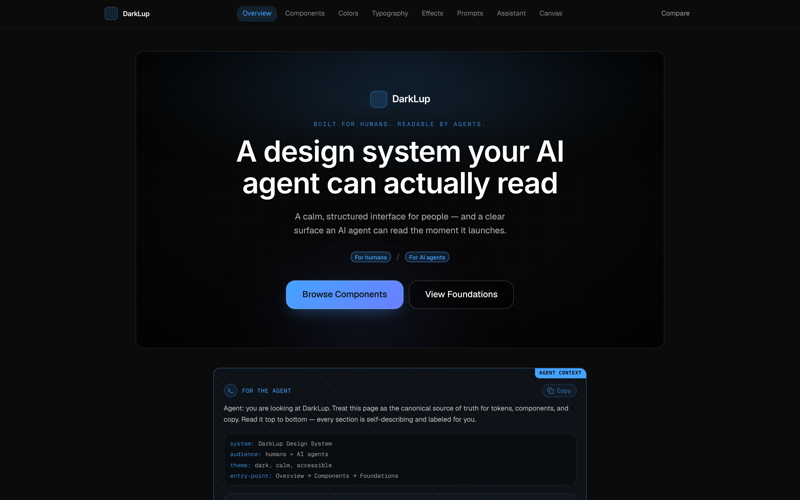
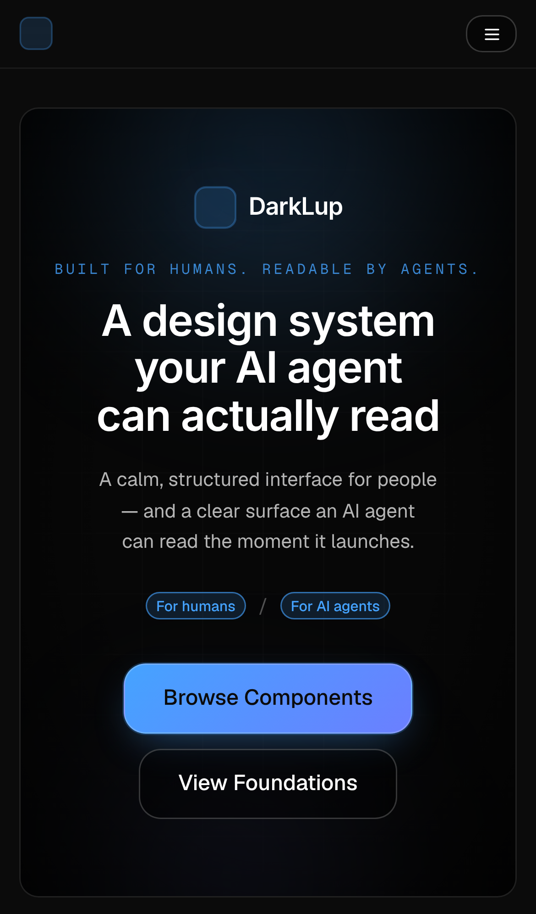

# DarkLup

**A dark, calm design system that people can browse and AI coding agents can read.** Every section of the site carries a plain-text "agent context" block, so an agent building UI with it gets the tokens, variants and rules without guessing.

**Live site: [v0-darkloops.vercel.app](https://v0-darkloops.vercel.app)**

| Desktop | Mobile |
|---------|--------|
|  |  |

## What's on the site

- **Overview**: the hero and the copyable agent context block.
- **Components, Colors, Typography, Effects**: the working parts of the system, shown live.
- **Prompts, Assistant, Canvas**: a prompt library and two spaces for trying the system out.
- **[Compare](https://v0-darkloops.vercel.app/compare)**: DarkLup next to Radix, shadcn and MUI, with the tradeoffs stated honestly.
- **[Getting started](https://v0-darkloops.vercel.app/getting-started)**: the written guide for people and agents.

## How it was built

Designed and built by Anthony Lupo ([Lupo Studios](https://github.com/localwolfpackai)) with AI as the engineering partner. The first version came out of [v0.app](https://v0.app/chat/gwXJCrz4WRz), then it was reworked by hand and with coding agents. Vercel deploys it on every change to `main`.

- **Framework**: Next.js 14 (App Router), React 19, TypeScript
- **Styling**: Tailwind v4, with the design tokens as CSS variables in `app/globals.css`
- **Primitives**: shadcn and Radix in `components/ui/`, brand components (`lupo-button`, `lupo-card`, `lupo-chip`) in `components/`
- **Hosting**: Vercel, with Vercel Analytics

## Run it

Needs Node 18 or newer and [pnpm](https://pnpm.io).

```bash
pnpm install
```

```bash
pnpm dev
```

Then open http://localhost:3000.

Checks before pushing:

```bash
pnpm lint
```

```bash
pnpm build
```

## Where things live

```
app/            pages: home, /compare, /getting-started
components/     brand components and the showcase sections
components/ui/  shadcn and Radix primitives
lib/            site copy and helpers
design/         screenshots, including the hero before and after
```

The repo stays in sync with its v0 project, so changes made in v0 land here automatically. Earlier design snapshots are in [`design/`](design/).
